<a id="top"></a>

<h1 align="center">🛡️ leakguard</h1>

<p align="center"><strong>When your VPN drops, the services you choose, such as Claude, go offline instead of leaking through your real connection.</strong></p>

<p align="center">
  <picture>
    <source media="(prefers-color-scheme: dark)" srcset="docs/assets/hero-dark.svg">
    
  </picture>
</p>

<p align="center">
  <a href="https://github.com/Isaacpaezz/leakguard/actions/workflows/ci.yml"></a>
  <a href="https://github.com/Isaacpaezz/leakguard/releases"></a>
  <a href="LICENSE"></a>
  
</p>

<p align="center">
  <a href="https://github.com/Isaacpaezz/leakguard/releases"><strong>⬇️ Download for macOS, Linux or Windows</strong></a><br>
  <sub>0.3.0 is a pre-release. macOS 13 or newer (Apple silicon or Intel), Linux with nftables and systemd (<code>.deb</code> and <code>.tar.gz</code>, amd64 and arm64), or Windows 10 and 11 (<code>setup.exe</code>, amd64 and arm64).</sub><br>
  <sub><a href="#which-file-do-i-download">Which file do I download?</a> · Install guides: <a href="docs/install-macos.md">macOS</a> · <a href="docs/install-linux.md">Linux</a> · <a href="docs/install-windows.md">Windows</a>.</sub>
</p>

<p align="center">
  <a href="#which-file-do-i-download">Install</a> ·
  <a href="#install-on-macos">macOS</a> ·
  <a href="#install-on-linux">Linux</a> ·
  <a href="#install-on-windows">Windows</a> ·
  <a href="#what-you-see">What you see</a> ·
  <a href="#how-it-works">How it works</a> ·
  <a href="#supported-services">Services</a> ·
  <a href="#whats-new">What's new</a> ·
  <a href="#roadmap">Roadmap</a> ·
  <a href="CONTRIBUTING.md">Contribute</a> ·
  <a href="#en-español">Español</a>
</p>

---

## The problem

In countries like Venezuela, many AI services (Claude, OpenAI and others) are
restricted, so people reach them through a VPN. Tools such as VPN Bypass send
**only** that traffic through the VPN and leave everything else on the normal
connection (*split tunneling*).

The risk shows up when the VPN drops. The operating system quietly falls
back to the real connection, and the service sees your real IP address.

leakguard is a **kill switch for the services you choose**, not for the whole
computer:

- ✅ You pick what to protect, such as Claude.
- 🔒 Those services can **only** be reached through the VPN.
- 📴 If the VPN drops, they act as if there were no internet. They never try
  your real connection.
- 🌐 Everything else (email, video, banking) keeps working normally.

## How it works

leakguard does **not** wait to "notice" that the VPN dropped; that would leave
a window where traffic could leak. The system firewall allows packets to the
protected services **only** on the VPN interface. On macOS this is a `pf`
anchor:

```
pass  out quick on <vpn-interface> to <protected-services> keep state
block return out quick to <protected-services>
```

On Linux, an `nftables` table rejects the same destinations outside the VPN,
both for the computer's own traffic and for the traffic it forwards for
Docker containers or libvirt virtual machines. On Windows, Windows Filtering
Platform filters block each protected range and allow it only when the
connection leaves through the VPN adapter.

If the VPN interface is gone, no allowed path is left and the connection fails
at once: in about 8 ms in our macOS tests, and in about 1 ms for a blocked
connection on Windows in CI. No detection race, and no leak. A background
service (a LaunchDaemon on macOS, a systemd service on Linux, a Windows
service) keeps the rules loaded from boot and checks them every 30 seconds.
One exception on Windows: WSL2, Hyper-V virtual machines, Hyper-V containers
and Docker Desktop do not go through leakguard yet (see
[Install on Windows](#install-on-windows)).

## What you see

A shield in the macOS menu bar, the Linux top bar (system tray) or the
Windows notification area. Its menu says whether you are protected, how your
VPN session is going, and how many times leakguard blocked a protected
service today (Windows does not show the blocks count yet). On macOS:

<p align="center">
  <picture>
    <source media="(prefers-color-scheme: dark)" srcset="docs/assets/menu-dark.svg">
    
  </picture>
</p>

The first time, a 3-step setup opens by itself, in your computer's language
(Spanish or English). You never type interface names such as `utun4` or
`ipsec0`: leakguard finds your VPN when you disconnect and connect it.

<p align="center">
  <picture>
    <source media="(prefers-color-scheme: dark)" srcset="docs/assets/setup-dark.svg">
    
  </picture>
</p>

A filled shield means protected; an outline means not protected or paused (the
first line of the menu says why); a shield with a slash means leakguard is not
set up yet. A **block** is a packet to a protected service that leakguard
rejected because it tried to leave outside the VPN, so it is an approximate
count of blocked connection attempts. "Today" starts at local midnight.

The same menu on Linux (GNOME top bar) and on Windows (notification area,
next to the clock):

<p align="center">
  <picture>
    <source media="(prefers-color-scheme: dark)" srcset="docs/assets/menu-linux-dark.svg">
    
  </picture>
  <picture>
    <source media="(prefers-color-scheme: dark)" srcset="docs/assets/menu-windows-dark.svg">
    
  </picture>
</p>

<details>
<summary>The 3-step setup on Linux and Windows</summary>

<p align="center">
  <picture>
    <source media="(prefers-color-scheme: dark)" srcset="docs/assets/setup-linux-dark.svg">
    
  </picture>
</p>

<p align="center">
  <picture>
    <source media="(prefers-color-scheme: dark)" srcset="docs/assets/setup-windows-dark.svg">
    
  </picture>
</p>

</details>

## Which file do I download?

Get it from [Releases](https://github.com/Isaacpaezz/leakguard/releases).
`VERSION` is the release number, for example `0.3.0`.

| Your computer | Download |
|---|---|
| Mac with Apple silicon or Intel, macOS 13 or newer | `leakguard-VERSION-macos.dmg` |
| Ubuntu, Debian or Mint PC (most PCs) | `leakguard_VERSION_amd64.deb` |
| 64-bit ARM Linux, such as a Raspberry Pi | `leakguard_VERSION_arm64.deb` |
| Other Linux with `nftables` and `systemd` | `leakguard-VERSION-linux-amd64.tar.gz` (`linux-arm64` on ARM) |
| Windows 10 or 11 PC (most PCs) | `leakguard-VERSION-windows-amd64-setup.exe` |
| Windows on ARM, such as Snapdragon | `leakguard-VERSION-windows-arm64-setup.exe` |

Optional: each file has a `.sha256` next to it to check the download is
complete: `shasum -a 256 -c FILE.sha256` on macOS, `sha256sum -c FILE.sha256`
on Linux, or `Get-FileHash FILE` in PowerShell on Windows (compare it with
the text of the `.sha256`).

## Install on macOS

> 0.3.0 is a pre-release. macOS 13 or newer, Apple silicon or Intel, and an
> administrator account on the Mac.

1. Download `leakguard-VERSION-macos.dmg` from
   [Releases](https://github.com/Isaacpaezz/leakguard/releases).
2. Open it and drag **leakguard** to **Applications**.
3. Open leakguard from Applications. The app is not signed with an Apple
   certificate yet, so macOS blocks it once: on macOS 15 or newer open
   **System Settings > Privacy & Security** and click **Open Anyway**; on
   macOS 13 or 14 right-click the app and choose **Open**.
4. Follow the 3-step setup that opens by itself. Your Mac asks for your
   password once. No terminal needed.

The app opens at every login (untick "Open at login" in its menu to stop
that). "Quit" closes only the menu; the protection keeps running. To remove
leakguard, choose "Uninstall leakguard…" in its menu, enter your password,
then drag the app to the Trash. Step-by-step guide in Spanish and English,
also inside the DMG: [docs/install-macos.md](docs/install-macos.md).

## Install on Linux

> A pre-release. The firewall is tested automatically with real `nftables`
> rules, but the tray icon and a real VPN drop have not yet been tried on a
> real Linux desktop. Please
> [report](https://github.com/Isaacpaezz/leakguard/issues/new?template=bug_report.yml)
> anything that does not work.

1. Download `leakguard_VERSION_amd64.deb` (most PCs) or
   `leakguard_VERSION_arm64.deb` (ARM, such as a Raspberry Pi) from
   [Releases](https://github.com/Isaacpaezz/leakguard/releases).
2. Install it: `sudo apt install ./leakguard_VERSION_amd64.deb` (Ubuntu,
   Debian, Mint). Other distributions use the `.tar.gz`; they need
   `nftables` and `systemd`.
3. Open leakguard from the applications menu and follow the same 3-step
   setup. The tray icon shows out of the box on Ubuntu; other GNOME desktops
   need the AppIndicator extension.

To remove it, choose "Uninstall leakguard…" in its menu, then
`sudo apt remove leakguard`. Step-by-step guide in Spanish and English,
including the command-line route:
[docs/install-linux.md](docs/install-linux.md).

## Install on Windows

> A pre-release. The firewall is tested automatically with real Windows
> Filtering Platform filters, but the tray icon, the installer on a real PC
> and a real VPN drop have not yet been tried on a real Windows PC. Please
> [report](https://github.com/Isaacpaezz/leakguard/issues/new?template=bug_report.yml)
> anything that does not work.

1. Download `leakguard-VERSION-windows-amd64-setup.exe` (most PCs) or
   `leakguard-VERSION-windows-arm64-setup.exe` (ARM, such as Snapdragon)
   from [Releases](https://github.com/Isaacpaezz/leakguard/releases).
   Windows 10 or 11, 64-bit.
2. Open it. It is not signed with a certificate yet, so Windows shows
   "Windows protected your PC": click **More info**, then **Run anyway**,
   and **Yes** at the administrator prompt.
3. Open leakguard from the Start menu and follow the same 3-step setup. The
   shield lives in the notification area; Windows may hide it behind the
   **^** arrow until you pin it. The blocks count is not shown on Windows
   yet.

WSL2, Hyper-V virtual machines, Hyper-V containers and Docker Desktop do not
go through leakguard yet: run Claude Code and similar tools directly on
Windows.

To remove it, uninstall leakguard from Settings > Apps: that also removes
the protection. Step-by-step guide in Spanish and English, including the
command-line route:
[docs/install-windows.md](docs/install-windows.md).

## Supported services

IP ranges live in [`catalog/services/`](catalog/services/), one file per
service, each with the sources that prove its ranges. This table is generated
from that catalog, so it is always current.

<!-- BEGIN GENERATED: services -->
| Service | Profile | Status | IPv4 ranges | IPv6 ranges | Last verified |
|---|---|---|---|---|---|
| Anthropic (Claude) | `anthropic` | ✅ Supported | 5 | 1 | 2026-11-15 |
| OpenAI (ChatGPT, Codex) | `openai` | 🗓️ Planned | – | – | – |
<!-- END GENERATED: services -->

Missing a service? [Request it](https://github.com/Isaacpaezz/leakguard/issues/new?template=service_request.yml).

## What's new

<!-- BEGIN GENERATED: whats-new -->
**v0.3.0** · 2026-11-23

leakguard for Windows (pre-release). Its firewall is tested
automatically with real Windows Filtering Platform filters, but the tray app,
the installer on a real PC and a real VPN drop have not yet been tried on a
real Windows PC: please report any problem.

**Added**
- Windows support: `setup.exe` installers for Windows 10 and 11 (amd64 and arm64), each with a SHA-256 checksum and an install guide in Spanish and English ([docs/install-windows.md](docs/install-windows.md)). They always install to Program Files, which only administrators can change (another folder is refused), with a Start menu entry; uninstalling from Settings > Apps also removes the protection, and running a newer installer restarts the background service with the new version, keeping your choices. Not signed with a certificate yet, so Windows asks you to allow it once ("More info", then "Run anyway").
- On Windows, a Windows Filtering Platform firewall blocks protected destinations outside the VPN at once; its filters stay loaded across restarts of the background service, and only VPN adapters are accepted as the VPN: Ethernet, Wi-Fi, loopback and virtual machine adapters never are.
- On Windows, a Windows service (`leakguard`, run as SYSTEM, started at boot and restarted when it fails) checks the rules every 30 seconds and as soon as the VPN connects or drops, and logs to `C:\ProgramData\leakguard\leakguard.log`; only administrators can change the protection through it, also from the tray app without elevation.
- On Windows, the tray app with the same menu, 3-step setup, session stats, "Open at login" and uninstall as on macOS, in Spanish or English like Windows, with one administrator prompt (UAC) per change; when a change fails, it shows the reason. The blocks count is not shown on Windows yet.
- Known limit on Windows: WSL2, Hyper-V virtual machines and Hyper-V containers do not go through leakguard yet, so if the VPN drops a program inside them can reach the protected services over the real connection; run Claude Code and similar tools directly on Windows.
<!-- END GENERATED: whats-new -->

Full history: [CHANGELOG.md](CHANGELOG.md).

## Roadmap

| Version | What | Status |
|---|---|---|
| 0.1.0 | macOS: menu-bar app, 3-step setup, Claude protection, DMG installer | ✅ First public version (pre-release) |
| 0.2.0 | Linux: `nftables` backend, systemd service, tray app, `.deb` and `.tar.gz` ([guide](docs/install-linux.md)) | ✅ Pre-release; the firewall is tested with real rules, the tray app not yet on a real desktop |
| 0.3.0 | Windows: Windows Filtering Platform backend, Windows service, tray app, `setup.exe` installer ([guide](docs/install-windows.md)) | ✅ Pre-release; the firewall is tested with real filters in CI, the tray app and the installer not yet on a real PC |
| 1.0 | [Milestone 1.0](https://github.com/Isaacpaezz/leakguard/milestone/1): ChatGPT/OpenAI ([#14](https://github.com/Isaacpaezz/leakguard/issues/14)), self-updating IP ranges ([#16](https://github.com/Isaacpaezz/leakguard/issues/16)), signed and notarized app ([#15](https://github.com/Isaacpaezz/leakguard/issues/15)), menu polish ([#8](https://github.com/Isaacpaezz/leakguard/issues/8)) | 🚧 Next |

Design notes and lessons learned: [docs/HANDOFF.md](docs/HANDOFF.md).

## Build from source

<details>
<summary>The <code>leakguard</code> command (contributors)</summary>

> Needs [Go](https://go.dev/dl/) 1.25 or newer. To build the same DMG as a
> release, see [CONTRIBUTING.md](CONTRIBUTING.md#build-the-macos-app); for
> the Linux packages and the Windows installers, see
> [Build the Linux packages](CONTRIBUTING.md#build-the-linux-packages) and
> [Build the Windows installers](CONTRIBUTING.md#build-the-windows-installers).
>
> The examples below are macOS (interface names such as `ipsec0`, paths and
> logs). The command-line route on Linux and Windows is in
> [docs/install-linux.md](docs/install-linux.md) and
> [docs/install-windows.md](docs/install-windows.md).

```sh
go install github.com/Isaacpaezz/leakguard/cmd/leakguard@latest
# or, from a clone of this repository: go build ./cmd/leakguard

leakguard services                             # what you can protect
leakguard interfaces                           # find your VPN interface (connect the VPN first)
sudo leakguard enable --vpn ipsec0 anthropic   # protect Claude through ipsec0
leakguard status                               # what is protected (sudo also verifies the rules)
leakguard test                                 # prove Claude is refused outside the VPN
sudo leakguard disable                         # turn it off; your choices are kept
```

`enable` loads the firewall rules and installs a background service
(`leakguard serve`, run by macOS as root) that loads them at boot, checks
them every 30 seconds, loads them again if the check fails, and logs each run
to `/Library/Logs/leakguard.log`. The same service listens on
`/var/run/leakguard.sock` for the menu-bar app, so you can change services
without typing your password each time. Only administrators of the Mac can
talk to it: the socket belongs to the `admin` group, and the service checks
who is calling and refuses everyone else. `leakguard status` asks it, so it
can tell you PROTECTED without `sudo`, and prints the session stats:

```
Session:             VPN connected for 2 h 15 min
Today:               14 blocks · VPN dropped 2 times · 5 h 20 min on the VPN
```

`test` connects through your real connection (Wi-Fi or Ethernet) and finds it
by itself even when the default route is the VPN; name it with `--via IFACE`
if you have several. Run `leakguard help` for every option.

The earlier shell prototype in [`prototypes/macos-pf`](prototypes/macos-pf/README.md)
is kept as a legacy reference. If you installed it, remove it with
`sudo prototypes/macos-pf/uninstall.sh` before using `leakguard`.

</details>

<details>
<summary>The menu-bar app (contributors)</summary>

You need the Xcode command line tools (`xcode-select --install`).

```sh
go build -o leakguard ./cmd/leakguard
go build -o leakguard-menubar ./cmd/leakguard-menubar && ./leakguard-menubar
```

The setup runs `leakguard enable --vpn IFACE SERVICE...` once as
administrator. Upgrading from an older leakguard (one installed before the
menu-bar app) uses the same setup with the `leakguard` command next to the
app; if there is none, the app tells you to put it there or run
`sudo leakguard enable`. "Change VPN…" runs step 2 again with no password.
Unticking the last service pauses the protection; `sudo leakguard enable` and
`sudo leakguard apply` also end a pause. Technical details, such as the VPN
interface name, today's time on the VPN and the version, are in the icon's
tooltip.

- **Session**: how long ago your VPN connected, or disconnected. The
  background service checks it every 5 seconds.
- **VPN dropped**: how many times your VPN went from connected to
  disconnected while the background service was watching.
- The numbers live in `/Library/Application Support/leakguard/stats.json` and
  survive restarts; time while the Mac sleeps is not counted.

Anything run as administrator uses the installed copy
`/usr/local/libexec/leakguard/leakguard` only when it is current and it, and
every folder above it, belongs to root and nobody else can change it;
otherwise the app refuses and asks you to reinstall with
`sudo leakguard enable`. The `leakguard` next to the app is used only for the
first install or to update an older one.

When the app runs from `leakguard.app`, it opens at login: it writes
`~/Library/LaunchAgents/dev.leakguard.menubar.plist` (no password) and
rewrites it if you move the app. "Open at login" turns that off and the app
remembers it in `~/Library/Application Support/leakguard/menubar.json`. Opened
from the disk image, it never writes the login item and the menu says "Move
leakguard to Applications so it opens at login". "Uninstall leakguard…" runs
`leakguard disable` once with your password (cancelling changes nothing),
removes the login item and quits. If the `leakguard` command inside a
downloaded app still carries macOS's quarantine mark, the app removes that
mark from its own command, and only that one, before running it; if it
cannot, it says so and points to the install guide.

</details>

## Contributing

Contributions are welcome. The most valuable one today is **keeping service IP
ranges accurate**. Read [CONTRIBUTING.md](CONTRIBUTING.md) to get started.
Using an AI assistant? Read [AGENTS.md](AGENTS.md) too.

- 🐛 [Report a bug](https://github.com/Isaacpaezz/leakguard/issues/new?template=bug_report.yml)
- ➕ [Request or update a service](https://github.com/Isaacpaezz/leakguard/issues/new?template=service_request.yml)
- 💡 [Suggest a feature](https://github.com/Isaacpaezz/leakguard/issues/new?template=feature_request.yml)
- 🔐 Found a leak or a security problem? Follow [SECURITY.md](SECURITY.md), not a public issue.

## Responsible use

leakguard is privacy and leak-prevention software. You are responsible for
following the terms of use of your VPN provider, your employer and every
service you protect.

## En español

### Qué es

**leakguard** bloquea los servicios que elijas, como Claude, cuando tu VPN se
cae. En lugar de usar tu conexión real y mostrar tu IP, esos servicios se
quedan sin internet hasta que la VPN vuelve. El resto de tu computadora
(correo, videos, banco) sigue funcionando con normalidad.

Está pensado para países como Venezuela, donde estos servicios están
restringidos y se usan a través de una VPN con *split tunneling* (por ejemplo,
VPN Bypass). La versión 0.3.0, para macOS, Linux y Windows, todavía es una
versión preliminar. Hoy protege Anthropic (Claude); ChatGPT
(OpenAI) llegará en la versión 1.0.

**[⬇️ Descargar para macOS, Linux o Windows](https://github.com/Isaacpaezz/leakguard/releases)**

Ya puedes usarlo en macOS (`.dmg`), Linux (`.deb` y `.tar.gz`) y Windows
(`setup.exe`). Linux y Windows son más nuevos: su protección se prueba
automáticamente, pero todavía no se ha probado en una computadora de verdad
con una VPN real. Mira la [guía para Linux](docs/install-linux.md) y la
[guía para Windows](docs/install-windows.md). Más abajo te decimos
[qué archivo descargar](#qué-archivo-descargo).

### Qué ves

Un escudo en la barra de menú de macOS, en la barra superior (bandeja del
sistema) de Linux o en el área de notificación de Windows. Su menú te dice si
estás protegido, cuánto tiempo lleva conectada tu VPN y cuántas veces
leakguard bloqueó hoy un servicio protegido (Windows todavía no muestra los
bloqueos). En macOS:

<p align="center">
  <picture>
    <source media="(prefers-color-scheme: dark)" srcset="docs/assets/menu-es-dark.svg">
    
  </picture>
</p>

La primera vez se abre sola una guía de 3 pasos, en el idioma de tu
computadora (español o inglés). No necesitas saber nombres
técnicos de tu VPN: leakguard la encuentra cuando la desconectas y la vuelves
a conectar.

<p align="center">
  <picture>
    <source media="(prefers-color-scheme: dark)" srcset="docs/assets/setup-es-dark.svg">
    
  </picture>
</p>

El escudo lleno significa que estás protegido; el escudo vacío, que no estás
protegido o que la protección está en pausa (la primera línea del menú dice
por qué). Un **bloqueo** es un intento de un servicio protegido de salir sin
la VPN que leakguard detuvo; es un conteo aproximado. "Hoy" empieza a la
medianoche.

El mismo menú en Linux (barra superior de GNOME) y en Windows (área de
notificación, junto al reloj):

<p align="center">
  <picture>
    <source media="(prefers-color-scheme: dark)" srcset="docs/assets/menu-linux-es-dark.svg">
    
  </picture>
  <picture>
    <source media="(prefers-color-scheme: dark)" srcset="docs/assets/menu-windows-es-dark.svg">
    
  </picture>
</p>

<details>
<summary>La configuración de 3 pasos en Linux y Windows</summary>

<p align="center">
  <picture>
    <source media="(prefers-color-scheme: dark)" srcset="docs/assets/setup-linux-es-dark.svg">
    
  </picture>
</p>

<p align="center">
  <picture>
    <source media="(prefers-color-scheme: dark)" srcset="docs/assets/setup-windows-es-dark.svg">
    
  </picture>
</p>

</details>

### ¿Qué archivo descargo?

Descárgalo desde [Releases](https://github.com/Isaacpaezz/leakguard/releases).
`VERSIÓN` es el número de la versión, por ejemplo `0.3.0`.

| Tu computadora | Descarga |
|---|---|
| Mac con Apple Silicon o Intel, macOS 13 o más nuevo | `leakguard-VERSIÓN-macos.dmg` |
| Computadora con Ubuntu, Debian o Mint (la mayoría) | `leakguard_VERSIÓN_amd64.deb` |
| Linux en ARM de 64 bits, como una Raspberry Pi | `leakguard_VERSIÓN_arm64.deb` |
| Otro Linux con `nftables` y `systemd` | `leakguard-VERSIÓN-linux-amd64.tar.gz` (`linux-arm64` en ARM) |
| PC con Windows 10 u 11 (la mayoría) | `leakguard-VERSIÓN-windows-amd64-setup.exe` |
| Windows en ARM, como Snapdragon | `leakguard-VERSIÓN-windows-arm64-setup.exe` |

Opcional: cada archivo trae al lado un `.sha256` para comprobar que llegó
completo: `shasum -a 256 -c ARCHIVO.sha256` en macOS,
`sha256sum -c ARCHIVO.sha256` en Linux, o `Get-FileHash ARCHIVO` en
PowerShell en Windows (compáralo con el texto del `.sha256`).

### Instalar en macOS

Necesitas macOS 13 o más nuevo (Apple Silicon o Intel) y una cuenta de
administrador de la Mac.

1. Descarga `leakguard-VERSIÓN-macos.dmg` desde
   [Releases](https://github.com/Isaacpaezz/leakguard/releases).
2. Ábrelo y arrastra **leakguard** a **Aplicaciones**.
3. Abre leakguard desde Aplicaciones. Como todavía no está firmada con un
   certificado de Apple, macOS la bloquea la primera vez: en macOS 15 o más
   nuevo ve a **Configuración del Sistema > Privacidad y seguridad** y haz
   clic en **Abrir igualmente**; en macOS 13 o 14 haz clic derecho sobre la
   app y elige **Abrir**.
4. Sigue los 3 pasos que aparecen solos. Tu Mac te pide tu contraseña una
   sola vez. No necesitas la Terminal.

leakguard se abre sola cada vez que entras a tu Mac (quita la marca de
**Abrir al iniciar sesión** en el menú si no lo quieres). **Salir** cierra
solo el menú: la protección sigue activa. Para pausarla, usa **Pausar la
protección**.

### Desinstalar en macOS

1. En el menú del escudo, elige **Desinstalar leakguard…** y confirma.
2. Escribe tu contraseña de la Mac. leakguard quita las reglas de protección,
   el servicio de fondo y la apertura al iniciar sesión, y se cierra.
3. Arrastra leakguard desde Aplicaciones a la Papelera.

Si cancelas, no se cambia nada.

### Instalar en Linux

Es una versión preliminar: el cortafuegos se prueba automáticamente con
reglas reales de nftables, pero el ícono de la bandeja y una caída real de la
VPN todavía no se han probado en un escritorio Linux de verdad. Si algo falla,
[cuéntanos](https://github.com/Isaacpaezz/leakguard/issues/new?template=bug_report.yml).

1. Descarga `leakguard_VERSIÓN_amd64.deb` (la mayoría de las computadoras) o
   `leakguard_VERSIÓN_arm64.deb` (ARM, como una Raspberry Pi) desde
   [Releases](https://github.com/Isaacpaezz/leakguard/releases).
2. Instálalo: `sudo apt install ./leakguard_VERSIÓN_amd64.deb`.
3. Abre leakguard desde el menú de aplicaciones y sigue los 3 pasos. En
   Ubuntu el escudo aparece solo; otros escritorios GNOME necesitan la
   extensión AppIndicator.

Guía completa, con el `.tar.gz` para otras distribuciones y la ruta por
terminal: [docs/install-linux.md](docs/install-linux.md).

### Instalar en Windows

Es una versión preliminar: el cortafuegos se prueba automáticamente con
filtros reales de la Plataforma de filtrado de Windows, pero el ícono de la
bandeja, el instalador en una PC real y una caída real de la VPN todavía no
se han probado en una PC con Windows de verdad. Si algo falla,
[cuéntanos](https://github.com/Isaacpaezz/leakguard/issues/new?template=bug_report.yml).

1. Descarga `leakguard-VERSIÓN-windows-amd64-setup.exe` (la mayoría de las
   PC) o `leakguard-VERSIÓN-windows-arm64-setup.exe` (ARM, como Snapdragon)
   desde [Releases](https://github.com/Isaacpaezz/leakguard/releases).
   Windows 10 u 11 de 64 bits.
2. Ábrelo. Como todavía no está firmado con un certificado, Windows muestra
   "Windows protegió tu PC": haz clic en **Más información**, luego en
   **Ejecutar de todas formas**, y en **Sí** cuando Windows pida permiso de
   administrador.
3. Abre leakguard desde el menú Inicio y sigue los 3 pasos. El escudo vive
   en el área de notificación; Windows puede esconderlo detrás de la flecha
   **^** hasta que lo fijes. En Windows todavía no se muestra el número de
   bloqueos.

WSL2, las máquinas virtuales de Hyper-V, los contenedores de Hyper-V y
Docker Desktop todavía no pasan por leakguard: usa Claude Code y
herramientas parecidas directamente en Windows.

Para quitarlo, desinstala leakguard desde Configuración > Aplicaciones: eso
también quita la protección. Guía completa, con la ruta por terminal:
[docs/install-windows.md](docs/install-windows.md).

### Enlaces

- Guía completa de instalación, también dentro del DMG:
  [docs/install-macos.md](docs/install-macos.md)
- Guía de instalación para Linux: [docs/install-linux.md](docs/install-linux.md)
- Guía de instalación para Windows: [docs/install-windows.md](docs/install-windows.md)
- Descargas: [Releases](https://github.com/Isaacpaezz/leakguard/releases)
- ¿Algo no funciona? [Reporta un problema](https://github.com/Isaacpaezz/leakguard/issues/new?template=bug_report.yml)
  (puedes escribir en español).
- ¿Quieres colaborar? Lee [CONTRIBUTING.md](CONTRIBUTING.md).

## License

[MIT](LICENSE) © 2026 Isaac Paez

<p align="right"><a href="#top">Back to top ↑</a></p>
