<a id="top"></a>

<h1 align="center">🛡️ leakguard</h1>

<p align="center"><strong>When your VPN drops, the services you choose, such as Claude, go offline instead of leaking through your real connection.</strong></p>

<p align="center">
  <picture>
    <source media="(prefers-color-scheme: dark)" srcset="docs/assets/hero-dark.svg">
    
  </picture>
</p>

<p align="center">
  <a href="https://github.com/Isaacpaezz/leakguard/actions/workflows/ci.yml"></a>
  <a href="https://github.com/Isaacpaezz/leakguard/releases"></a>
  <a href="LICENSE"></a>
  
</p>

<p align="center">
  <a href="https://github.com/Isaacpaezz/leakguard/releases"><strong>⬇️ Download for macOS or Linux</strong></a><br>
  <sub>0.2.0 is a pre-release. macOS 13 or newer (Apple silicon or Intel), or Linux with nftables and systemd (<code>.deb</code> and <code>.tar.gz</code>, amd64 and arm64): <a href="docs/install-linux.md">Linux install guide</a>.</sub>
</p>

<p align="center">
  <a href="#install-on-macos">Install</a> ·
  <a href="#install-on-linux">Linux</a> ·
  <a href="#what-you-see">What you see</a> ·
  <a href="#how-it-works">How it works</a> ·
  <a href="#supported-services">Services</a> ·
  <a href="#whats-new">What's new</a> ·
  <a href="#roadmap">Roadmap</a> ·
  <a href="CONTRIBUTING.md">Contribute</a> ·
  <a href="#en-español">Español</a>
</p>

---

## The problem

In countries like Venezuela, many AI services (Claude, OpenAI and others) are
restricted, so people reach them through a VPN. Tools such as VPN Bypass send
**only** that traffic through the VPN and leave everything else on the normal
connection (*split tunneling*).

The risk shows up when the VPN drops. The operating system quietly falls
back to the real connection, and the service sees your real IP address.

leakguard is a **kill switch for the services you choose**, not for the whole
computer:

- ✅ You pick what to protect, such as Claude.
- 🔒 Those services can **only** be reached through the VPN.
- 📴 If the VPN drops, they act as if there were no internet. They never try
  your real connection.
- 🌐 Everything else (email, video, banking) keeps working normally.

## How it works

leakguard does **not** wait to "notice" that the VPN dropped; that would leave
a window where traffic could leak. The firewall allows packets to the
protected services **only** on the VPN interface:

```
pass  out quick on <vpn-interface> to <protected-services> keep state
block return out quick to <protected-services>
```

If the VPN interface is gone, no allowed path is left and the connection fails
at once: in about 8 ms in our macOS tests. No detection race, and no leak.
On macOS this is a `pf` anchor, and on Linux an `nftables` table, kept by a
background service that loads it at boot and checks it every 30 seconds.

## What you see

A shield in the menu bar. Its menu says whether you are protected, how your
VPN session is going, and how many times leakguard blocked a protected
service today:

<p align="center">
  <picture>
    <source media="(prefers-color-scheme: dark)" srcset="docs/assets/menu-dark.svg">
    
  </picture>
</p>

The first time, a 3-step setup opens by itself, in your Mac's language
(Spanish or English). You never type interface names such as `utun4` or
`ipsec0`: leakguard finds your VPN when you disconnect and connect it.

<p align="center">
  <picture>
    <source media="(prefers-color-scheme: dark)" srcset="docs/assets/setup-dark.svg">
    
  </picture>
</p>

A filled shield means protected; an outline means not protected or paused (the
first line of the menu says why); a shield with a slash means leakguard is not
set up yet. A **block** is a packet to a protected service that leakguard
rejected because it tried to leave outside the VPN, so it is an approximate
count of blocked connection attempts. "Today" starts at local midnight.

## Install on macOS

> 0.2.0 is a pre-release. macOS 13 or newer, Apple silicon or Intel, and an
> administrator account on the Mac.

1. Download `leakguard-VERSION-macos.dmg` from
   [Releases](https://github.com/Isaacpaezz/leakguard/releases).
2. Open it and drag **leakguard** to **Applications**.
3. Open leakguard from Applications. The app is not signed with an Apple
   certificate yet, so macOS blocks it once: on macOS 15 or newer open
   **System Settings > Privacy & Security** and click **Open Anyway**; on
   macOS 13 or 14 right-click the app and choose **Open**.
4. Follow the 3-step setup that opens by itself. Your Mac asks for your
   password once. No terminal needed.

The app opens at every login (untick "Open at login" in its menu to stop
that). "Quit" closes only the menu; the protection keeps running. To remove
leakguard, choose "Uninstall leakguard…" in its menu, enter your password,
then drag the app to the Trash. Step-by-step guide in Spanish and English,
also inside the DMG: [docs/install-macos.md](docs/install-macos.md).

## Install on Linux

> A pre-release. The firewall is tested automatically with real `nftables`
> rules, but the tray icon and a real VPN drop have not yet been tried on a
> real Linux desktop. Please
> [report](https://github.com/Isaacpaezz/leakguard/issues/new?template=bug_report.yml)
> anything that does not work.

1. Download `leakguard_VERSION_amd64.deb` (most PCs) or
   `leakguard_VERSION_arm64.deb` (ARM, such as a Raspberry Pi) from
   [Releases](https://github.com/Isaacpaezz/leakguard/releases).
2. Install it: `sudo apt install ./leakguard_VERSION_amd64.deb` (Ubuntu,
   Debian, Mint). Other distributions use the `.tar.gz`; they need
   `nftables` and `systemd`.
3. Open leakguard from the applications menu and follow the same 3-step
   setup. The tray icon shows out of the box on Ubuntu; other GNOME desktops
   need the AppIndicator extension.

To remove it, choose "Uninstall leakguard…" in its menu, then
`sudo apt remove leakguard`. Step-by-step guide in Spanish and English,
including the command-line route:
[docs/install-linux.md](docs/install-linux.md).

## Supported services

IP ranges live in [`catalog/services/`](catalog/services/), one file per
service, each with the sources that prove its ranges. This table is generated
from that catalog, so it is always current.

<!-- BEGIN GENERATED: services -->
| Service | Profile | Status | IPv4 ranges | IPv6 ranges | Last verified |
|---|---|---|---|---|---|
| Anthropic (Claude) | `anthropic` | ✅ Supported | 5 | 1 | 2026-11-15 |
| OpenAI (ChatGPT, Codex) | `openai` | 🗓️ Planned | – | – | – |
<!-- END GENERATED: services -->

Missing a service? [Request it](https://github.com/Isaacpaezz/leakguard/issues/new?template=service_request.yml).

## What's new

<!-- BEGIN GENERATED: whats-new -->
**v0.2.0** · 2026-11-23

leakguard for Linux (pre-release). Its firewall is tested automatically with
real nftables rules, but the tray app and a real VPN drop have not yet been
tried on a real Linux desktop: please report any problem.

**Added**
- Linux support: a `.deb` for Ubuntu, Debian and Mint (amd64 and arm64) and a `.tar.gz` for other distributions, each with a SHA-256 checksum and an install guide in Spanish and English ([docs/install-linux.md](docs/install-linux.md)). Removing the package also removes the rules and the background service; purging it also deletes your choices, the stats and the log. Upgrading the package restarts the background service with the new version, keeping your choices and the rules loaded.
- On Linux, an nftables firewall (table `inet leakguard`) rejects protected destinations outside the VPN at once, also for the traffic the computer forwards for containers and virtual machines (Docker, libvirt), and only real tunnels are accepted as the VPN: Ethernet, Wi-Fi, USB tethering, Docker, bridges and loopback never are.
- On Linux, a systemd service (`leakguard.service`) loads the rules before the network starts, checks them every 30 seconds and logs to `/var/log/leakguard.log` (rotated weekly, 4 weeks kept); only root and the administrators group (`sudo`, `wheel` or `admin`) can change the protection through it.
- On Linux, the tray app with the same menu, 3-step setup, session stats, "Open at login" and uninstall as on macOS, with zenity (or kdialog) windows and one administrator prompt per change through pkexec (never remembered for other programs).

**Changed**
- Fail closed when the saved VPN turns out to be a real connection (for example a phone's USB tethering, which cannot be told apart from a VPN by its name while it is unplugged): the protected services are blocked on every interface until you choose your VPN again, instead of keeping rules that allowed it. `leakguard status` says why and `sudo leakguard apply` exits with an error.
<!-- END GENERATED: whats-new -->

Full history: [CHANGELOG.md](CHANGELOG.md).

## Roadmap

| Version | What | Status |
|---|---|---|
| 0.1.0 | macOS: menu-bar app, 3-step setup, Claude protection, DMG installer | ✅ First public version (pre-release) |
| 0.2.0 | Linux: `nftables` backend, systemd service, tray app, `.deb` and `.tar.gz` ([guide](docs/install-linux.md)) | ✅ Pre-release; the firewall is tested with real rules, the tray app not yet on a real desktop |
| 0.3.0 | Windows: Windows Filtering Platform backend, Windows service, tray app, `.exe` installer | 🧪 Built and tested in CI, not released yet |
| 1.0 | [Milestone 1.0](https://github.com/Isaacpaezz/leakguard/milestone/1): ChatGPT/OpenAI ([#14](https://github.com/Isaacpaezz/leakguard/issues/14)), self-updating IP ranges ([#16](https://github.com/Isaacpaezz/leakguard/issues/16)), signed and notarized app ([#15](https://github.com/Isaacpaezz/leakguard/issues/15)), menu polish ([#8](https://github.com/Isaacpaezz/leakguard/issues/8)) | 🚧 Next |

Design notes and lessons learned: [docs/HANDOFF.md](docs/HANDOFF.md).

## Build from source

<details>
<summary>The <code>leakguard</code> command (contributors)</summary>

> Needs [Go](https://go.dev/dl/) 1.25 or newer. To build the same DMG as a
> release, see [CONTRIBUTING.md](CONTRIBUTING.md#build-the-macos-app).

```sh
go install github.com/Isaacpaezz/leakguard/cmd/leakguard@latest
# or, from a clone of this repository: go build ./cmd/leakguard

leakguard services                             # what you can protect
leakguard interfaces                           # find your VPN interface (connect the VPN first)
sudo leakguard enable --vpn ipsec0 anthropic   # protect Claude through ipsec0
leakguard status                               # what is protected (sudo also verifies the rules)
leakguard test                                 # prove Claude is refused outside the VPN
sudo leakguard disable                         # turn it off; your choices are kept
```

`enable` loads the firewall rules and installs a background service
(`leakguard serve`, run by macOS as root) that loads them at boot, checks
them every 30 seconds, loads them again if the check fails, and logs each run
to `/Library/Logs/leakguard.log`. The same service listens on
`/var/run/leakguard.sock` for the menu-bar app, so you can change services
without typing your password each time. Only administrators of the Mac can
talk to it: the socket belongs to the `admin` group, and the service checks
who is calling and refuses everyone else. `leakguard status` asks it, so it
can tell you PROTECTED without `sudo`, and prints the session stats:

```
Session:             VPN connected for 2 h 15 min
Today:               14 blocks · VPN dropped 2 times · 5 h 20 min on the VPN
```

`test` connects through your real connection (Wi-Fi or Ethernet) and finds it
by itself even when the default route is the VPN; name it with `--via IFACE`
if you have several. Run `leakguard help` for every option.

The earlier shell prototype in [`prototypes/macos-pf`](prototypes/macos-pf/README.md)
is kept as a legacy reference. If you installed it, remove it with
`sudo prototypes/macos-pf/uninstall.sh` before using `leakguard`.

</details>

<details>
<summary>The menu-bar app (contributors)</summary>

You need the Xcode command line tools (`xcode-select --install`).

```sh
go build -o leakguard ./cmd/leakguard
go build -o leakguard-menubar ./cmd/leakguard-menubar && ./leakguard-menubar
```

The setup runs `leakguard enable --vpn IFACE SERVICE...` once as
administrator. Upgrading from an older leakguard (one installed before the
menu-bar app) uses the same setup with the `leakguard` command next to the
app; if there is none, the app tells you to put it there or run
`sudo leakguard enable`. "Change VPN…" runs step 2 again with no password.
Unticking the last service pauses the protection; `sudo leakguard enable` and
`sudo leakguard apply` also end a pause. Technical details, such as the VPN
interface name, today's time on the VPN and the version, are in the icon's
tooltip.

- **Session**: how long ago your VPN connected, or disconnected. The
  background service checks it every 5 seconds.
- **VPN dropped**: how many times your VPN went from connected to
  disconnected while the background service was watching.
- The numbers live in `/Library/Application Support/leakguard/stats.json` and
  survive restarts; time while the Mac sleeps is not counted.

Anything run as administrator uses the installed copy
`/usr/local/libexec/leakguard/leakguard` only when it is current and it, and
every folder above it, belongs to root and nobody else can change it;
otherwise the app refuses and asks you to reinstall with
`sudo leakguard enable`. The `leakguard` next to the app is used only for the
first install or to update an older one.

When the app runs from `leakguard.app`, it opens at login: it writes
`~/Library/LaunchAgents/dev.leakguard.menubar.plist` (no password) and
rewrites it if you move the app. "Open at login" turns that off and the app
remembers it in `~/Library/Application Support/leakguard/menubar.json`. Opened
from the disk image, it never writes the login item and the menu says "Move
leakguard to Applications so it opens at login". "Uninstall leakguard…" runs
`leakguard disable` once with your password (cancelling changes nothing),
removes the login item and quits. If the `leakguard` command inside a
downloaded app still carries macOS's quarantine mark, the app removes that
mark from its own command, and only that one, before running it; if it
cannot, it says so and points to the install guide.

</details>

## Contributing

Contributions are welcome. The most valuable one today is **keeping service IP
ranges accurate**. Read [CONTRIBUTING.md](CONTRIBUTING.md) to get started.
Using an AI assistant? Read [AGENTS.md](AGENTS.md) too.

- 🐛 [Report a bug](https://github.com/Isaacpaezz/leakguard/issues/new?template=bug_report.yml)
- ➕ [Request or update a service](https://github.com/Isaacpaezz/leakguard/issues/new?template=service_request.yml)
- 💡 [Suggest a feature](https://github.com/Isaacpaezz/leakguard/issues/new?template=feature_request.yml)
- 🔐 Found a leak or a security problem? Follow [SECURITY.md](SECURITY.md), not a public issue.

## Responsible use

leakguard is privacy and leak-prevention software. You are responsible for
following the terms of use of your VPN provider, your employer and every
service you protect.

## En español

### Qué es

**leakguard** bloquea los servicios que elijas, como Claude, cuando tu VPN se
cae. En lugar de usar tu conexión real y mostrar tu IP, esos servicios se
quedan sin internet hasta que la VPN vuelve. El resto de tu Mac (correo,
videos, banco) sigue funcionando con normalidad.

Está pensado para países como Venezuela, donde estos servicios están
restringidos y se usan a través de una VPN con *split tunneling* (por ejemplo,
VPN Bypass). La versión 0.2.0, para macOS y Linux, todavía es una versión
preliminar. Hoy protege Anthropic (Claude); ChatGPT
(OpenAI) llegará en la versión 1.0.

**[⬇️ Descargar para macOS](https://github.com/Isaacpaezz/leakguard/releases)**

Linux (`.deb` y `.tar.gz`) llega como versión preliminar: mira la
[guía de instalación para Linux](docs/install-linux.md).

### Qué ves

Un escudo en la barra de menú. Su menú te dice si estás protegido, cuánto
tiempo lleva conectada tu VPN y cuántas veces leakguard bloqueó hoy un
servicio protegido:

<p align="center">
  <picture>
    <source media="(prefers-color-scheme: dark)" srcset="docs/assets/menu-es-dark.svg">
    
  </picture>
</p>

La primera vez se abre sola una guía de 3 pasos. No necesitas saber nombres
técnicos de tu VPN: leakguard la encuentra cuando la desconectas y la vuelves
a conectar.

<p align="center">
  <picture>
    <source media="(prefers-color-scheme: dark)" srcset="docs/assets/setup-es-dark.svg">
    
  </picture>
</p>

El escudo lleno significa que estás protegido; el escudo vacío, que no estás
protegido o que la protección está en pausa (la primera línea del menú dice
por qué). Un **bloqueo** es un intento de un servicio protegido de salir sin
la VPN que leakguard detuvo; es un conteo aproximado. "Hoy" empieza a la
medianoche.

### Instalar en macOS

Necesitas macOS 13 o más nuevo (Apple Silicon o Intel) y una cuenta de
administrador de la Mac.

1. Descarga `leakguard-VERSIÓN-macos.dmg` desde
   [Releases](https://github.com/Isaacpaezz/leakguard/releases).
2. Ábrelo y arrastra **leakguard** a **Aplicaciones**.
3. Abre leakguard desde Aplicaciones. Como todavía no está firmada con un
   certificado de Apple, macOS la bloquea la primera vez: en macOS 15 o más
   nuevo ve a **Configuración del Sistema > Privacidad y seguridad** y haz
   clic en **Abrir igualmente**; en macOS 13 o 14 haz clic derecho sobre la
   app y elige **Abrir**.
4. Sigue los 3 pasos que aparecen solos. Tu Mac te pide tu contraseña una
   sola vez. No necesitas la Terminal.

leakguard se abre sola cada vez que entras a tu Mac (quita la marca de
**Abrir al iniciar sesión** en el menú si no lo quieres). **Salir** cierra
solo el menú: la protección sigue activa. Para pausarla, usa **Pausar la
protección**.

### Desinstalar

1. En el menú del escudo, elige **Desinstalar leakguard…** y confirma.
2. Escribe tu contraseña de la Mac. leakguard quita las reglas de protección,
   el servicio de fondo y la apertura al iniciar sesión, y se cierra.
3. Arrastra leakguard desde Aplicaciones a la Papelera.

Si cancelas, no se cambia nada.

### Instalar en Linux

Es una versión preliminar: el cortafuegos se prueba automáticamente con
reglas reales de nftables, pero el ícono de la bandeja y una caída real de la
VPN todavía no se han probado en un escritorio Linux de verdad. Si algo falla,
[cuéntanos](https://github.com/Isaacpaezz/leakguard/issues/new?template=bug_report.yml).

1. Descarga `leakguard_VERSIÓN_amd64.deb` (la mayoría de las computadoras) o
   `leakguard_VERSIÓN_arm64.deb` (ARM, como una Raspberry Pi) desde
   [Releases](https://github.com/Isaacpaezz/leakguard/releases).
2. Instálalo: `sudo apt install ./leakguard_VERSIÓN_amd64.deb`.
3. Abre leakguard desde el menú de aplicaciones y sigue los 3 pasos. En
   Ubuntu el escudo aparece solo; otros escritorios GNOME necesitan la
   extensión AppIndicator.

Guía completa, con el `.tar.gz` para otras distribuciones y la ruta por
terminal: [docs/install-linux.md](docs/install-linux.md).

### Enlaces

- Guía completa de instalación, también dentro del DMG:
  [docs/install-macos.md](docs/install-macos.md)
- Guía de instalación para Linux: [docs/install-linux.md](docs/install-linux.md)
- Descargas: [Releases](https://github.com/Isaacpaezz/leakguard/releases)
- ¿Algo no funciona? [Reporta un problema](https://github.com/Isaacpaezz/leakguard/issues/new?template=bug_report.yml)
  (puedes escribir en español).
- ¿Quieres colaborar? Lee [CONTRIBUTING.md](CONTRIBUTING.md).

## License

[MIT](LICENSE) © 2026 Isaac Paez

<p align="right"><a href="#top">Back to top ↑</a></p>
